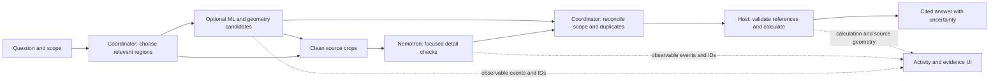

# Evidence experience and model-use plan

Status: proposed follow-on work, 14 November 2026. The toolbar Follow toggle is
implemented now; the remaining behavior below is a plan, not a shipped contract.
Coordinate the specialist integration with the active Nemotron-routing work.

## Outcome and current baseline

An engineer should be able to answer three questions without reading a tool log:
what part of the drawing is being checked, what was found there, and which
evidence supports the final answer. The plan should remain readable throughout.

Reuse the existing run API, source-frame validation, live region outlines, chat
work log, Task details, comparison layers, inline final citations and PDF export.
Do not build another inspector or duplicate the activity feed. The large floating
plan card has been removed. Follow is an optional icon in the drawing toolbar;
manual pan, wheel and zoom pause it. Live source outlines and chat steps remain.

At the published baseline (`4e3f9e9`), events are grouped mainly by tool name,
which cannot safely pair parallel specialist calls. The active routing work is
already introducing inspection IDs; adopt and extend that contract. Generated
evidence is not the same as evidence supplied to a model; final citations do not
explicitly record candidate disposition or coverage. A source crop is not a
record of attention. Calibration consistency does not establish the correctness
of a selected room boundary.

## Truthful presentation is a release requirement

The user explicitly requires good UX without disguising poor ML or deterministic
results. Improve legibility, grouping and interaction; never improve the apparent
quality of the evidence through presentation alone.

- Default to readable, question-relevant evidence. Keep the full candidate output
  inspectable with its original producer and status. Filtering is a viewing choice,
  not deletion or silent reclassification of wrong results.
- Unresolved conflicts, incomplete coverage, unsupported units and uncertain
  boundaries that affect the answer stay visible beside that answer. They must
  not require opening Diagnostics to discover why the result is unreliable.
- A resolved false positive can leave the default overlay after a recorded,
  source-based exclusion; retain the candidate, exclusion reason and source in
  details. A low-quality prediction must not quietly become a confirmed object.
- Use labels such as "candidate", "source check returned", "disputed" and
  "referenced in answer". A green check for completed work means the tool
  returned, not that its finding is true. Do not attach a universal "verified"
  badge to an answer because its arithmetic or citation bounds passed validation.
- If algorithms fail or produce unusable output, explain the relevant limitation
  in plain language and show which source checks support the remaining answer.
  Do not animate a successful analysis or imply that a fallback was corroborated.
- Keep uncertainty consistent across the answer, overlay, task details and PDF.
  Do not display polished certainty in one surface and a qualification elsewhere.

Evaluate with deliberately wrong boxes, conflicting classes, missing regions and
unusable geometry as well as successful cases. The user should recognize the
limitation, inspect the original source and understand the next useful action.
A tidy page with concealed uncertainty fails this design, even if it looks good.

## Experience while the task runs

The conversation contains one compact current-task row and an expandable work
list, using language tied to observable actions:

- **Locating relevant areas**: source overview and selected scope.
- **Finding candidates**: ML and geometry work actually requested by the agent.
- **Checking details**: focused specialist inspections, grouped by region.
- **Resolving differences**: a recorded conflict, duplicate or missing region.
- **Calculating / preparing answer**: completed input checks and host calculation.

These are display groups, not a required sequence. Display only steps that ran;
parallel and cached work do not pretend to be a linear pipeline. While background
algorithms are pending, source inspection can continue. Show measured elapsed
time or explicit region completions, not invented percentages or time remaining.

Expanding a step reveals its purpose, source thumbnail, returned findings and
unresolved items. A region card might say “Room entrance: two door candidates;
one may belong to the adjacent room.” The card opens the exact unchanged crop.
Show public evidence summaries and explicit decisions, never hidden model thoughts
or provider payloads. Technical tool names belong in Diagnostics.

On the drawing, emphasize the current requested region with a restrained dashed
outline. Retained regions are labelled as previous inspection regions. When Follow
is off, new work never moves the viewport. When on, coalesce parallel updates into
a useful region/group rather than jumping between every tile; manual navigation
pauses it immediately. Explicit source selection remains available in either mode.

## Presenting ML, rules and measurement evidence

| Evidence | Display and meaning |
| --- | --- |
| ML detection | Thin dashed candidate box; label “ML candidate”. A prediction, not a confirmed physical object. |
| Independent pixel/geometry rules | Distinct line pattern and labelled rule cue; show measured support such as a swing arc or parallel strokes. Not a correctness percentage. |
| ML-assisted room/wall geometry | Separate labelled layer; record its dependence on ML. Never describe agreement with its own ML input as independent confirmation. |
| Specialist finding | Source crop and cited finding with status/uncertainty; link to candidate IDs when applicable. |
| Evidence referenced by the answer | Restrained solid outline and numbered source link; label “Referenced in answer”, not “verified”. |
| Disagreement or missing coverage | Amber outline plus icon/text, with both observations available. Do not conceal the weaker result. |
| Measured area | Actual measurement polygon and holes, calibration spans and unit citations; distinguish measured boundary from a rectangular citation highlight. |

Do not color the whole page with every raw candidate. Default to question-relevant
regions and final answer references. The existing Task details inspector provides
the evidence list, class filters and ML/rules comparison slider. Distinguish items
by pattern, icon and label as well as color. Mobile uses the same source cards and
list; desktop hover is never the only way to inspect an item.

For areas, display the boundary basis (“inside wall faces”), source dimensions,
formula and approximation with the result. Selecting the boundary or an anchor
focuses that geometry. This is especially important where a narrow corridor can
produce materially different estimates from small boundary or termination changes.
Boundary editing is outside this increment; do not imply the user corrected a
measurement merely by moving the viewport or selecting a source.

## One evidence contract for both the UI and the models

Extend existing records rather than inventing separate UI evidence. Proposed
fields below require implementation and versioning before they are relied on:

- Stable `call_id`, `parent_call_id` and batch/region/tile IDs on start/result
  events, with sequence and source hash/page/frame. Match parallel work by ID,
  never by tool name or arrival order. Preserve retry lineage and cache origin.
- Stable evidence IDs, producer/source family, native geometry, category,
  observation and limitations. Retain source readings separately from inferred
  classifications. Identify ML-derived geometry's parent evidence IDs.
- Host-owned delivery receipts: which evidence and image IDs were included in
  which model request. Record supplied resolution and source transforms. “Supplied
  to model” is observable; “the model understood it” is not.
- Explicit coverage: requested scope, inspected regions and failed/deferred tiles.
  A crop box or a finished worker alone does not prove complete counting coverage.
- Model-proposed reconciliation: accepted, excluded as duplicate/out of scope,
  disputed or unresolved, with evidence references and a short public reason.
  Preserve this as a decision proposal, not an independent verification.
- Final claim links: source citations, relevant evidence IDs, inspected scope and
  measurement ID where applicable. Retain the existing numeric/units binding.

Represent availability, delivery and final citation as separate fields. For
example, a result can be available but not supplied, supplied but not cited, or
disputed and still cited. Cached results retain these distinctions. The UI must
not infer usage from completion order or from a layer being visible on screen.

## Correct responsibilities and evidence flow

1. The coordinator determines scope and requests relevant candidate classes or
   source regions. Algorithms help locate and structure the task; they do not
   supply an authoritative count or establish that missing detections are absent.
2. Nemotron inspects the actual source pixels for a focused question: symbol role,
   room entrance context, printed dimension/unit, or boundary. The active routing
   work owns batching, tiling, budgets and any required delegation. Keep that
   policy in one backend location; visualization must not silently change it.
3. The coordinator receives structured findings and provenance. Reconcile overlap
   in canonical coordinates; never sum overlapping tile counts. Keep conflicting
   ML/rule/specialist observations visible. Weak rules must not veto a visible
   object solely because no rule candidate was returned.
4. The host enforces source/frame/reference validity, actual tool completion,
   permissions and budgets. An answer cannot use a result that has not returned.
   References must point to evidence actually supplied in the relevant context.
   Those checks validate provenance, not the truth of the model's reading.
5. Area answers retain the existing successful measurement-ID requirement, source
   unit/calibration checks and approximate raster flag. Proposed boundaries and
   readings still need source review. For counts, unresolved relevant tiles prevent
   a claim of complete coverage; answer a supported partial scope or abstain.

The UI consumes this recorded contract. Opening a layer, expanding a step,
replaying history or exporting a report never starts new inference. A user request
for a new check is a separate explicit action and run, not a hover side effect.

## Delivery order and acceptance

**1. Event and delivery contracts first.** Add correlation IDs, receipts and
coverage to the existing observer/run projection; keep old runs readable. Older
history says “usage not recorded” where appropriate. Test interleaved results,
failed tile plus successful neighbors, retry lineage, pending work, cache reuse,
source mismatch and late background results. No false “used in answer” badge.

**2. Compact activity and source interaction.** Evolve the existing chat work log
and Task details into grouped steps/region cards. Connect Follow to source-group
events; retain pause-on-navigation. Verify keyboard/touch access, reduced motion,
320px layout, reconnect and history replay. A static screenshot must make the
active region and outstanding work understandable without reading raw tool JSON.

**3. Evidence-to-answer links and area overlays.** Add source/usage labels, candidate
decisions and claim links in the existing inspector. Render real measurement
polygons, holes and anchors. Verify mixed-scale pages, false detections, overlapping
tiles, unitless dimensions, uncertain boundaries and contradictions. An overlay
can explain a result but must never imply that geometry alone proves it correct.

**4. Validate before claiming improvement.** First replay recorded traces with
zero provider calls and compare visible states against actual receipts. Then use
a small fixed, authorized set of real questions. Compare correctness, coverage,
latency and provider calls with the current baseline. Test whether a user can
locate the supporting source and identify why an answer is approximate or partial.
Keep human reference labels out of inference; retain unsuccessful runs.

The release criterion is faithful, usable evidence presentation with unchanged
or explicitly measured answer behavior. More animation, more tools or agreement
between dependent models is not evidence of better accuracy.
