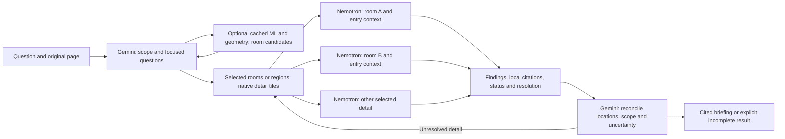

# Focused parallel inspection

Interactive `auto` and `visual_only` questions now require cited Nemotron inspection
before an answered result can be accepted. Gemini locates the scope, delegates the
detail work, reconciles findings and produces the briefing. The explicit `direct`
comparison mode remains a Gemini-only benchmark; the product always uses `auto`.



## One tool turn for dispatch

`inspect_regions` accepts one to six independent targets. Each needs its own focused
question and exactly one registered `room_id` or normalized original-page `bbox`.

```json
{"regions":[
  {"room_id":"R1","question":"Identify the apartment entrance connecting to the corridor. Cite each candidate and explain any ambiguity in its role."},
  {"bbox":[450,150,650,450],"question":"Inspect this apartment and its corridor boundary for its main entrance. Cite individual door locations; distinguish internal doors."}
]}
```

Room proposals come from `get_algorithms`; they are navigation hints, not complete or
independently verified segmentation. Room crops include an 8% context margin (at least
16 source pixels). Explicit boxes allow Gemini to include the corridor, labels and
relevant adjoining spaces or inspect a room the algorithms missed. Background algorithms
remain optional and never block visual delegation while pending.

The host tiles oversized selections into crops of at most 1536 by 1536 source pixels,
with 96 pixels of overlap. Tile sizes are balanced within the selected region to avoid
tiny edge strips or almost identical repeated crops. These tiles require no client-side
downsampling under the existing 2048-pixel encoder limit. JPEG encoding still applies; the original source
is retained unchanged. No interpolation can recover detail missing from the source.
The provider may apply its own preprocessing; its deployed resolution policy is unknown.

Each tile gets an independent Nemotron request. Four workers are shared across questions,
so they execute concurrently instead of adding a Gemini round trip per crop. Successful
responses return as structured findings, local pixel citations, canonical locations,
source/sent dimensions, downscale ratios and per-tile timing. Gemini normally receives
metadata and findings for these tiles, not the entire batch of image payloads. Existing
crop tools remain available for deliberate visual follow-up. Recovery also retains tile
evidence and metadata without reattaching every delegated image.

## Coverage and failures

- Cited findings unlock only inspected source regions. Final citations, including host
  measurement inputs, must be covered by the union of those regions. A failed call or
  an unrelated inspection cannot authorize an answer elsewhere. Citation containment
  checks spatial scope, **not semantic correctness or whole-page completeness**.
- No tile counts are summed by the host. Door counting now uses a localized object
  inventory and conservative geometric deduplication; see [Localized counting](LOCALIZED_COUNTING.md).
  Overlapping views can contain the same object.
  Gemini must reconcile canonical locations, include boundary objects once and retain
  ambiguity. For apartment entrances, a door symbol alone does not establish its role.
- Failed tiles do not discard successful neighbors. A repeated batch reuses successful
  inspections; a failed tile may be retried once. Retry identity includes the question
  and exact source box. Missing or unreadable evidence never becomes zero.
- Unresolved requested tiles are attached to final uncertainty even if Gemini omits them.
  The host does not certify a complete count from partial coverage. A supported partial
  answer must clearly restrict its scope; otherwise the agent should abstain.
- A second attempt to bypass mandatory inspection ends with an incomplete result instead
  of spending every remaining Gemini turn repeating the refusal.
- The existing explicit Gemini/Nemotron permissions apply. Missing Nemotron permission
  stops the interactive request before any external model call; it is never inferred.

## Initial operating limits and tuning

These defaults are an initial engineering profile, **not a measured optimum**:

| Control | Initial value | Purpose |
| --- | ---: | --- |
| Concurrent Nemotron requests across the process | 4 | Parallel room checks without unlimited provider pressure |
| Native tile long edge | 1536 px | Preserve small symbols instead of shrinking a large wing |
| Tile overlap | 96 px | Retain boundary context; requires duplicate reconciliation |
| Specialist requests per interactive question | 18 | More room-level work than the previous 3-call cap |
| Registered crops per interactive question | 30 | Inspection tiles and deliberate follow-up crops |
| Per specialist request | 30 s maximum socket timeout | Clipped to remaining inspection time |
| Interactive admission budget / finalization reserve | 120 s / 35 s | Reuse evidence and leave time for synthesis |

A batch that would exceed the remaining call/crop allowance dispatches feasible tiles
in the requested priority order and explicitly reports every deferred tile with its
bounds and reason. Gemini can prioritize smaller relevant regions; the host does not
silently skip tiles or reject feasible work. Queued work is checked
against the deadline before sending; at the batch deadline pending work is cancelled,
late results are discarded and already completed evidence remains usable. Running HTTP
calls have a socket timeout, not guaranteed immediate cancellation at the remote service.

Tune with a paired, human-labelled set of simple and dense room/door/stair questions:
compare 1024/1536/2048 pixel tiles and 2/4 concurrent workers with identical questions and
source images. Record answer correctness, entry-role errors, missing/duplicate objects,
coverage, resolution, call count, provider failures and end-to-end latency. Increasing
resolution/call count is justified only when it resolves useful evidence. Do not trade
away corridor context just to produce tiny cheap crops. Any provider tests require
authorization to send the selected private drawings; no new live calls were made for
this implementation. The earlier 73 s / 44 s stair timings tested optional delegation and
must not be presented as results of this mandatory parallel policy.

## Research boundary

The configured service is `nemotron-3.5-super-vl`. NVIDIA's official
[deployment guide](https://docs.nvidia.com/nemo-helix/latest/documentation/models-and-inference/deploy-models/#deploy-nemotron-35-super-vl)
identifies model-specific serving requirements; it does not establish this event endpoint's
actual image preprocessing. NVIDIA's earlier
[Nano V2 VL technical report](https://research.nvidia.com/labs/adlr/files/NVIDIA-Nemotron-Nano-V2-VL-report.pdf)
describes resolution-dependent image tiling. That supports investigating crop detail,
but its 512 pixel internal tile setting must **not** be assumed for the deployed Super 3.5
model. Sources observed 2026-11-14. The 1536 pixel host setting above is a testable hypothesis.

## Verification

346 Python tests, Ruff, TypeScript/build and four focused browser checks passed.
Scripted tests exercise concurrency, native tile coverage, coordinate transforms,
source-bound mandatory delegation, partial failures, retry reuse, late-result isolation,
permission guards, measurement integration and recovery. The browser test checks that
concurrent workers keep their own region and completion state. These verify contracts,
not actual provider performance or answer accuracy. Private drawings, provider traces,
credentials and training data stay outside version control.
