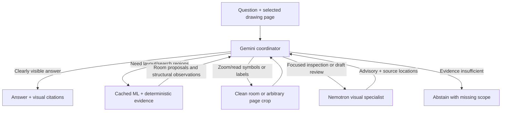

# Question-aware Gemini agent

Gemini receives the question and a clean drawing overview first. It may answer
directly, zoom into the source, ask Nemotron for a focused visual inspection, or
request ML/geometry evidence. Algorithms are no longer a mandatory first step.



## Intended behavior

| Question | Useful path | Boundary |
| --- | --- | --- |
| How many floor layouts are displayed? | Gemini overview, potentially direct answer | Displayed layouts do not establish the building's total storeys. |
| How many bathtubs? | Gemini visual search; optionally room proposals, clean crops and Nemotron | The detector has no bathtub class. Missing detections cannot mean zero. |
| How many windows? | Structural proposals and disagreement checks may help, then source inspection | Neither raw candidate counts nor method agreement is ground truth. |
| What is the room's printed area? | Read its label from a clean crop | No metric area calculation from pixels without verified calibration. |

Three selectable modes allow a controlled comparison:

- `direct`: Gemini overview and final answer only. No algorithms, crops or Nemotron.
- `visual_only`: crops and optional Nemotron inspection/review, with algorithms disabled by the host.
- `auto`: Gemini chooses from all authorized tools, including the cached algorithms.

Pilot policy update (2026-11-14): Nemotron inspection and draft review accept only
registered detail crops, each at most 75% of the original page area. Overview and
page-sized crop requests are rejected before provider access. Gemini still sees
the overview and chooses whether any tool is worthwhile. Optional `reflect`
records one concise draft/coverage/uncertainty check and the intended next action;
it calls no external model and does not certify correctness. Reflection is not
forced on obvious direct answers. These changes pass 130 backend/feedback tests.

These are capabilities and tested execution policies, not claims that Gemini will
always make the best decision. Source citations validate identity and bounds;
their semantic support still needs human/evaluator review.

## Implementation and teammate integration

The base includes Imad/Johan's `iamd-johan-dev@82eeee5`. The updated branch was
fetched and reviewed at `7803f6c` on 2026-11-14; its Gemini/Nemotron code performs
disputed-door arbitration, not general question routing. This implementation
reuses the canonical upload, source-frame, FastAPI, frontend and Google GenAI SDK
boundaries, and builds a general coordinator in `backend/question_agent.py`.
It deliberately retains the validated main room engine instead of overwriting it
with the teammate branch's divergent deterministic package. Neither teammate
branch is overwritten. The old door demonstration and fixed `/reason` experiment
remain separate; the primary question endpoint is now `/ask`.

The host owns source paths, model settings, worker executables, registered room
IDs and crop transforms. Native PDF rendering preserves up to a 3200-pixel long
edge (also bounded by 4x scale and 16 million pixels); model overviews are resized
separately to 2048. Crops come from the retained canonical pixels, never from an
annotated overlay. Input support is one selected PNG/JPEG/PDF page. This agent
does not infer missing pages or construct 3D/BIM geometry.

To reduce noise, model-facing evidence uses short `R`, `O` and `G` IDs. The full
ID mapping stays in the host trace. Repeated algorithm requests return only newly
requested classes; room observations are not duplicated beside the room catalog.
Images sent to Gemini include relevant frame metadata, not provenance hashes.
The host still retains all hashes/transforms and source artifacts for verification.

## Tools and execution rules

| Tool | Inputs | Actual action |
| --- | --- | --- |
| `get_algorithms` | supported class names | Lazily runs frozen ML, independent pixels/geometry and ML-assisted room boundaries; filters the compact catalog. |
| `crop_room` | registered short ID such as `R1` | Host maps to the exact room proposal and crops original page pixels with context margin. |
| `crop_region` | normalized original-page `[x0,y0,x1,y1]` in 0..1000 | Creates a clean source crop even if algorithms are unavailable or missed a region. |
| `inspect_nemotron` | registered image IDs, focused question | Real Nemotron visual answer for those images only. |
| `review_answer` | draft and registered image IDs | One optional Nemotron visual feedback pass. Works without any algorithms. |
| `reflect` | short draft, evidence checks, unresolved issues, next action | One optional recorded Gemini self-check; no provider call and no hidden reasoning trace. |
| `submit_answer` | answer/abstention, citations, coverage, uncertainties | Host validates output and maps citations back to original page coordinates. |

Registered images carry sent size, source identity, pixel scaling, canonical crop
bounds and affine transforms. Gemini citations use sent-image pixel coordinates;
crop requests use normalized original-page coordinates. The host rejects unknown
IDs, invalid boxes, arbitrary paths and unsupported tools/classes. Unclassified
pixel cues are safely excluded from class filters, not treated as detector errors.
Nemotron uses a separate normalized 0..1000 **local image** citation contract;
the host withholds page offsets, validates bounds and converts its results back
through the original crop transform. Its tool returns descriptive findings as
well as optional scalar answers; unsupported object categories do not require a
detector class. Invalid specialist output remains unavailable evidence. Algorithm
subprocesses receive no API key variables. A failed tool returns an unavailable
observation, not zero or a fabricated detection. Gemini can continue visually.

Budgets: eight normal Gemini turns, twelve non-final tool attempts, six distinct crops,
three Nemotron calls including at most one review. Identical successful tool
requests are cached per question. There is a 600-second admission budget checked
before turns/tools; the last 120 seconds are reserved for finalization. Gemini
has cancellable 90-second attempts, at most three attempts per normal turn and
twelve per question. One evidence-preserving final-answer recovery turn can
follow an interruption, with at most two attempts and no new observation tools.
Backoff, Retry-After and process-local cooldown prevent unbounded retries.
Nemotron retains 90 seconds without retry, algorithm workers 240 each; in-flight
tools can finish after the admission deadline. See
[AGENT_RELIABILITY.md](AGENT_RELIABILITY.md) for exact behavior and telemetry.
Authentication/invalid requests are not retried. Failed attempts may incur cost.
Final answers retain the full overview context. Overlapping crops must not be
summed blindly, and inspecting a subset does not establish whole-page coverage.

The SDK's original model `Content`, including thought signatures and function
call IDs, is preserved in the conversation; the host executes declared tools
manually. Credentials, raw provider exceptions and hidden thought content are not
included in the response or trace. This follows Google's function-calling boundary:
[official guide](https://ai.google.dev/gemini-api/docs/function-calling), observed
2026-11-14; installed `google-genai` 2.34.0. Configure an available model explicitly;
the example uses the documented [Carbon model](https://ai.google.dev/gemini-api/docs/models).

Nemotron interactive calls explicitly disable thinking with
`chat_template_kwargs.enable_thinking=false`, use a 4096-token output budget,
90-second timeout and no transport retry. This avoids silently spending the
entire answer budget on hidden reasoning. The original direct benchmark settings
and results remain unchanged. See NVIDIA's
[model card](https://huggingface.co/nvidia/NVIDIA-Nemotron-3.5-Super-VL-120B-A12B-BF16)
and [NIM instructions](https://docs.nvidia.com/nim/large-language-models/2.1.5/get-started/advanced/get-started-nemotron-3.5-super-vl.html),
observed 2026-11-14.

## Run locally

Use the separate worker environments described in the ML and deterministic guides.
In a host environment install `backend/requirements.txt` and `feedback[test]`:

```powershell
python -m pip install -r backend/requirements.txt -e 'feedback[test]'
python backend/run_local.py --ml-python <ml-python.exe> --geometry-python <geometry-python.exe> --env-file <private-nemotron.env> --gemini-env-file .env --port 8002
```

Local `.env` needs `GEMINI_API_KEY` and `GEMINI_MODEL`. The Nemotron env file needs
`NVIDIA_NEMOTRON_KEY`. Never commit either file. Keys are read at request time,
so saving the Gemini key does not require restarting the app. Model weights are
the approved `models/baselines/v1/corrected-3500-global` bundle; download LFS
objects first. Open `http://127.0.0.1:8002/planwise/`, upload a drawing and ask a
question. Gemini and optional Nemotron access are separately selected.

HTTP: upload via `POST /api/documents`; then
`POST /api/v1/documents/{document_id}/ask` with:

```json
{"question":"How many bathtubs are shown?","mode":"auto","allow_gemini":true,"allow_nemotron":true}
```

`GET /api/v1/agent` reports configuration presence, not verified connectivity.
Responses include the answer, coverage, uncertainties, canonical citations,
actual tools used, model, timings and provider usage. Private traces go to
`.artifacts/agent/questions/`; algorithm files go to `.artifacts/agent/jobs/`.
The launcher binds only localhost. Existing UI door controls use separate legacy
configuration; the new question panel is the general agent entry point.

## Validation and honest performance boundary

Latest mixed 50-question result: adaptive **33/50 (66%)**, direct **27/50 (54%)**,
with 15 versus 20 execution failures. All six gains were on direct execution
failures; on 29 cases where both answered, both scored 27/29. No general moat or
semantic correction advantage is established. See [the full cohort report](AGENT_COHORT50.md)
for categories, reliability, timing, token usage and limitations.

Latest full eight-question result: adaptive and fresh direct Gemini each scored
**7/8**, missing the same window-count case, with no execution/tool failures.
Adaptive routing chose algorithms once, five Nemotron calls on detail crops,
and four optional self-checks. It used more time/tokens without an accuracy gain
on this previously inspected cohort. See [the frozen pilot report](AGENT_PILOT_RESULTS.md)
for routing, timings, the shared mistake, validation and local artifact paths.
The older experiments below remain a historical record, not the latest score.

Host tests exercise direct routing without models, room-assisted search, visual
feedback without algorithms, citation transforms, permissions, failed-tool visual
fallback, signature retention, caching, budgets and provider failure redaction.
The browser test uses a real upload and an explicitly simulated answer; it is not
an accuracy test. Run:

```powershell
python -m pytest backend feedback/tests -q
node tools/test_question_agent_ui.mjs
```

The earlier algorithm-first Nemotron experiments did not demonstrate a gain:

| Experiment | Direct control | Algorithm-guided | Limit |
| --- | --- | --- | --- |
| Original Nemotron benchmark | 35/100 strict | N/A | 30 truncated responses, 14 invalid citation outputs, two transport failures. |
| Controlled eight-question pilot | 3/8 | 2/8 | Two routing budget errors; small source-balanced development subset. |
| Same subset, bounded overview fallback | Same fixed 3/8 | 1/8 | One invalid room ID; repeated development set, no tuning claim. |

These scores are NOT scores for this Gemini coordinator. A runner compares the
three new modes on identical canonical pages and questions, saving every tool
trace. Reference answers are opened only after all inference attempts finish.
The previously inspected pilot remains a development check, not held-out evidence:

```powershell
$env:PLANPROOF_GEMINI_ENV_FILE = '.env'
$env:PLANPROOF_ENV_FILE = '<private-nemotron.env>'
$env:PLANPROOF_ML_PYTHON = '<ml-python.exe>'
$env:PLANPROOF_DETERMINISTIC_PYTHON = '<geometry-python.exe>'
python tools/benchmark_agent.py --pack <frozen-pack> --selection <pilot-binding.json> --count 2 --out .artifacts/agent-comparison-v1
```

The output directory must be new. Records contain strict scores, failures, source
hashes, actual routing, latency and separate condition traces. Do not report an
accuracy improvement until the real run establishes one. No training labels,
source datasets, model changes or private results are part of this source commit.

Development verification on 2026-11-14: 127 backend/feedback tests and 69 geometry
tests passed. The browser checks cover modes, real upload, explicit provider
consent, simulated answer/citation display, clearing stale page results, mobile
layout and the actual offline comparison viewer. Those checks are not QA scores.

The initial live Gemini comparison used the first two existing pilot questions:
displayed floor layouts and showers/bathtubs. After a bounded transient-connection
retry was added, all three conditions scored 2/2 with no execution failures. The
floor question used no observation tools; the fixture question used Nemotron in
the tool-enabled conditions. Algorithms were not needed on these two cases, so
this result demonstrates routing behavior, not an algorithm accuracy gain.
An additional explicit full-pipeline probe exposed and fixed unclassified pixel
cues in the class filter and motivated the normalized specialist crop contract.
Earlier traces are preserved, including failures; further runs remain separate.

The final two-question comparison with normalized specialist citations again
scored 2/2 in each mode, without execution failures. Total elapsed times for both
questions were 35.9s direct, 56.5s visual-only and 67.7s automatic. Automatic routing
used three crops and one Nemotron call for the fixture question. These timings
are observations from one tiny run, not stable latency guarantees. An explicit
whole-page window-count probe subsequently delivered valid algorithm and Nemotron
evidence but timed out during Gemini synthesis after 277s. It returned no asserted
answer. This remains a known live-provider/reasoning latency limitation; do not
describe that probe as a successful count or hide it from the handoff.

After compact/incremental evidence was implemented, a separate real HTTP room
integration check completed successfully in 126.1s: Gemini requested algorithms,
selected registered room `R2`, called `crop_room`, obtained valid Nemotron findings,
and returned an answered description with six canonical citations. Algorithm
preparation took 19.7s and Nemotron 0.75s; the remainder was primarily Gemini/API
latency. This verifies the complete live tool chain, not the correctness of an
exact window count. All failed and successful traces remain local. The latest
source passes 196 Python tests across host/feedback/geometry plus seven browser
checks; remote CI has not been run for this local commit.
