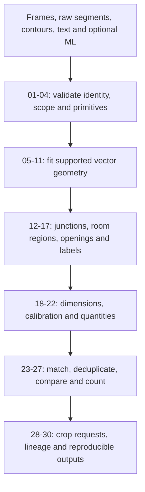

# Algorithm catalogue and integration rules

Status: **proposed v1 implementation inventory, not implemented or benchmarked**.
Updated 14 November 2026. This makes Track 2 executable against generated inputs
while Track 1 develops. Read [contracts](CONTRACTS.md) and
[Track 2 ownership](TRACK-2-GEOMETRY.md) with this catalogue.

Every algorithm returns its observations, parent IDs, parameters and diagnostics.
No numerical threshold below is a measured Stoa optimum. Fixed requirements are
marked **invariant**; geometric thresholds are versioned development parameters.

## Processing order



Run independent classical/native geometry without ML input. Run ML-guided geometry
as a separate branch with inherited dependencies. Raw masks/segments remain
immutable; a repaired/fitted object never replaces its underlying observation.

## A. Input, identity and scope

| ID | Algorithm | Inputs and output | Mandatory rules and failure behavior |
| --- | --- | --- | --- |
| T2-01 | Frame and identity validation; homogeneous coordinate transforms | Page frame and artifacts to validated canonical geometry | Same source/raster/page binding; finite invertible transforms; pixel-edge xyxy. Reject mismatched ML bindings. Different dimensions alone cannot prove or disprove image identity without a recorded transform. |
| T2-02 | Native PDF primitive extraction | PDF to characters, lines, curves, fills and styles | Use pdfplumber through the shared page transform. Keep native source IDs and text orientation. Scanned pages may supply no native vectors; PNG never requires this path. |
| T2-03 | View/scope partitioning and exclusion tagging | Page regions and layout cues to scoped observation sets | Keep separate plan views, details and legends when supported. Do not silently discard unknown regions or count across duplicate views. If view identification is unresolved, report page-region candidate counts rather than an asserted building total. |
| T2-04 | Primitive normalization and exact deduplication | Segments/rings to deterministic normalized primitives | Remove only exact duplicates/degenerate zero-length items, retaining all parent IDs. Canonicalize segment orientation modulo180degrees. Reject nonfinite values; report invalid rings instead of silently repairing them. |

## B. Pixel evidence to vector geometry

| ID | Algorithm | Inputs and output | Mandatory rules and failure behavior |
| --- | --- | --- | --- |
| T2-05 | Douglas-Peucker contour simplification with topology checks | Contour rings to compact boundary polygons | Bound displacement in canonical pixels; preserve holes, components and openings. Reject a simplification that introduces intersections, changes containment or exceeds the area/fit limits; retain the original contour. |
| T2-06 | Skeletonization and skeleton-path extraction | Appropriate binary wall-body candidate to center paths | Use thinning with8-connected path tracing; preserve endpoints, branches and loops. No unconditional spur pruning. Skeletons from ML masks are hybrid evidence. Arbitrary ink skeletons are not automatically wall centerlines. |
| T2-07 | Euclidean distance-transform thickness estimation | Filled wall body plus center path to local thickness samples | Estimate twice the distance to background at non-junction centerline samples; keep median/spread. Do not estimate body thickness from a single outline stroke or junction bulge. Unsupported thickness stays unknown. |
| T2-08 | Hough candidate extraction and orthogonal least-squares line fitting | Skeleton/raw segment points to fitted line candidates | Hough suggests candidates; fit them to their actual support points and record residuals. Keep diagonal directions. A poor fit stays a polyline or rejected candidate; do not force it onto an axis. |
| T2-09 | Collinear interval merging | Compatible fitted lines to merged supported intervals | Require orientation, perpendicular distance and projected support compatibility. Merge overlaps/contiguous supported spans; do not silently bridge an opening or white-space interval. Bound cluster-wide drift, not just successive pair distances. |
| T2-10 | Paired-boundary wall hypothesis generation | Nearby parallel lines to wall-body/axis candidates | Measure perpendicular separation and common overlap, not distance from the global origin. Prefer locally consistent opposing boundaries, retain competing pairings, and exclude obvious hatch/text/grid patterns only with recorded cues. No fixed metre thickness range. |
| T2-11 | Bounded ink-distance and direction-aware snapping | Candidate boundaries plus observed ink to refined boundary alternatives | Snap only where local edge direction and ink support improve. Bound displacement; preserve openings/holes/slanted walls. Reject a prettier but less supported fit. ML-clipped ink cannot become independent support. |

Boundary and centerline representations answer different questions. Keep both
when available; a wall-axis region is not the same area as a room interior.
Retain native PDF curves or a recorded tolerance-bounded approximation; do not
approximate all curves as right-angle corners.

## C. Topology, rooms, openings and labels

| ID | Algorithm | Inputs and output | Mandatory rules and failure behavior |
| --- | --- | --- | --- |
| T2-12 | Segment noding, bounded junction clustering and path graph | Supported segments/path evidence to nodes, edges and junction types | Split at supported intersections. Nearby endpoints need compatible direction/path support; a near miss is not automatically a junction. Bound total cluster diameter to prevent transitive collapse of separate walls. Keep ambiguous crossings unresolved. |
| T2-13 | Evidence-gated bridge proposals | Dangling compatible endpoints to explicit inferred-edge candidates | Pixel-supported short repairs and virtual room separators remain distinguishable from observed wall material. Do not bridge merely to obtain a closed room. Reject unsupported bridges across visible openings; dependent regions inherit the hypothesis. |
| T2-14 | Planar polygonization with full diagnostics | Noded boundary graph to faces, cut edges, dangles and invalid rings | Use Shapely polygonize_full; preserve all diagnostics. Polygonize only compatible scope/frame/representation. Do not report every closed face as a semantic room. |
| T2-15 | Interior-region construction and hole-aware region classification | Faces, wall bodies, free space and labels to room-region candidates | Separate wall material, courtyards/exterior and enclosed interior candidates. Preserve holes/components; do not fill every hole. Open-plan names and enclosed faces can differ. Incomplete/repaired boundaries remain visible. |
| T2-16 | Opening-to-wall association and local-axis projection | Opening candidates plus nearby wall geometry to attachment alternatives | Require compatible position, orientation and visible gap/leaf/parallel-line cues. Project supported endpoints onto the local wall axis. ML box or symbol extent alone is not exact clear-opening width. Keep unattached/ambiguous openings. |
| T2-17 | Region/text association | Native/OCR spans plus regions to label/name associations | Use containment, overlap and orientation/context; preserve original text and source. Do not attach by nearest centroid through a wall or force a unique label when several regions are plausible. ML room category remains a separate proposal. |

Graph edges, enclosed faces and connected masks are geometric units, not counts
of physical walls or rooms. A virtual separator across a doorway may help describe
rooms but must never be exported as an observed solid wall or independent proof.

## D. Dimensions, calibration and derived quantities

| ID | Algorithm | Inputs and output | Mandatory rules and failure behavior |
| --- | --- | --- | --- |
| T2-18 | Contextual dimension/area/unit parsing | Raw spans and notation context to parsed alternatives | Support explicit mm/cm/m, feet/inches and squared units when unambiguous. Preserve decimal/grouping ambiguities. Bare2400/2.40/4 does not establish units or room-number semantics. Keep raw text, original units and OCR uncertainty. |
| T2-19 | Dimension-line/text/endpoint association | Parsed candidates, dimension lines, ticks/arrows and extension lines to anchored measures | Score orientation, proximity and endpoint/extension evidence within one view. Retain alternatives; nearest text alone is insufficient. Distinguish measured object length from a nearby total dimension or height annotation. |
| T2-20 | Robust, scoped scale estimation and verification | Anchored dimensions/manual calibration/native scale candidates to calibration records | Use ratios of declared physical lengths to corresponding pixel spans; robust median/consensus exposes outliers. Require independent consistent anchors for automatic promotion. Printed scale alone, typical doors and assumed image DPI never assert physical scale. Keep conflicting detail-view calibrations separate. |
| T2-21 | Length, polygon area and unit conversion | Supported geometry and optional calibration to derived quantities | Area is outer area minus holes, summed over components. Keep printed/calculated, net/gross/axis definitions separate. Unknown scale yields pixel quantities only; no assumed-height volumes. Carry all calculation parents and units. |
| T2-22 | Containment, adjacency and passage relations | Room/opening/wall geometry to typed spatial relationships | Use geometric predicates and supported shared boundaries. Distinguish touching, sharing a wall and having a door/passage. Nearby centroids do not establish adjacency; adjacency does not establish a traversable route. |

For uniform calibrated scale `s` metres per canonical pixel:

```text
length_m = length_px * s
area_m2 = (outer_area_px2 - sum(hole_areas_px2)) * s**2
```

Do not apply those formulas to an anisotropically distorted image. Separate x/y
scales or a more general calibration need an explicit validated metric transform;
otherwise physical geometry remains unresolved. A printed dimension can still be
reported as source text without calibrating unrelated parts of the image.

For near-parallel lines, align tangent direction `u` and compute normal
`n = (-u_y, u_x)`. Compare normal offsets `dot(n, p)` over the common projected
interval. This is translation-invariant; subtracting absolute offset magnitudes
is not a valid general separation formula.

## E. ML comparison, object identities and counts

| ID | Algorithm | Inputs and output | Mandatory rules and failure behavior |
| --- | --- | --- | --- |
| T2-23 | STRtree spatial candidate search | Scoped observations to nearby match candidates | Index2D bounding boxes; perform exact geometry/semantic tests afterward. Rebuild after geometry changes. Nearest bounding box is not an object match. |
| T2-24 | Gated minimum-cost bipartite assignment | Compatible ML/geometric candidates to proposed one-to-one correspondences | Use overlap, boundary distance, orientation and semantics with logged normalized costs. Add explicit unmatched options so assignment never forces a bad match. Preserve one-to-many/split-merge alternatives and ambiguous near ties; cost is not correctness confidence. |
| T2-25 | Conservative physical-identity grouping | Proposed matches and source-specific objects to duplicate groups | Preserve all source observations and member IDs. Avoid transitive overlap chains collapsing distinct adjacent doors/rooms. An unresolved split/merge does not acquire one certain identity. Do not sum ML and geometric counts. |
| T2-26 | Typed agreement/conflict classification | Matched/unmatched candidates and measures to comparison records | Compare compatible quantity definitions/scales. Distinguish class, geometry and measurement conflicts from unmatched objects and unavailable sources. Do not call ML-derived vectors independent confirmation or treat detector absence as a contradiction. |
| T2-27 | Scope-aware counting and aggregation | Identity groups, coverage and counting definitions to member-backed counts | Count explicitly defined door assemblies/leaves, flights/treads, semantic rooms/regions. Preserve per-source counts. Partial coverage or unresolved identities prevents an asserted exact physical total; report detected-candidate counts, alternatives and limitations instead. |

Assignment is performed between identified source sets, not against one flattened
list containing duplicates from both ML models. Class-incompatible coincident
candidates can be tested separately for a class conflict; do not discard them
silently just because they failed the compatible-class matching gate.

## F. Verifiable and efficient output

| ID | Algorithm | Inputs and output | Mandatory rules and failure behavior |
| --- | --- | --- | --- |
| T2-28 | Conflict-region construction and crop requests | Relevant observations to bounded source-crop requests | Include competing geometry plus local label/dimension/wall context. Preserve unclipped requested and clipped actual regions. Request clean crops from Track1; do not erase contextual evidence to make a detector appear right. No Jev call in this phase. |
| T2-29 | Provenance-DAG validation and stable evidence assembly | All observations/quantities/comparisons to final versioned JSON/overlay primitives | Every derived object names parents; reject cycles, dangling IDs and frame mismatch. Track dependencies through fitting, repaired topology and quantities. Preserve raw results and source-specific score semantics. |
| T2-30 | Comparison caching, deterministic ordering and cost instrumentation | Bound source/config/model identities to cached comparisons and measured execution | ML changes invalidate hybrid/comparison results, not independent extraction unnecessarily. Sort IDs/ties consistently, record seeds and versioned parameters. Measure CPU time, memory, cache hits and failure counts; no hidden inference API calls. |

## Initial development parameters

These are conservative **starting proposals**, not guarantees. Record them in a
versioned configuration and validate against generated fixtures before real data.
Do not silently change them after looking at sealed final answers.

| Parameter | Initial proposal | Why it stays tunable |
| --- | --- | --- |
| Near-parallel angular gate | 5degrees | Drawing skew and curve approximations differ |
| Paired-line projected overlap fraction | At least0.5 of the shorter supported interval | Partial occlusion and dense hatching need different tradeoffs |
| Contour simplification epsilon | 0.5 estimated stroke widths, capped at2canonical pixels | Protect small openings and holes; reject topology changes regardless of epsilon |
| Local snapping/junction search cap | 2 estimated stroke widths | It is only a search radius; actual pixel/path support is still mandatory |
| Automatic unsupported gap merging | Disabled | No search tolerance grants permission to invent a wall connection |
| Automatic Manhattan/right-angle snapping | Disabled | Real drawings include diagonal/curved walls |
| Polygon match seed gate | IoU0.5 for comparable area objects | Not suitable alone for thin lines, tiny objects or split/merge cases |
| Automatic scale promotion | At least2distinct, nonduplicate consistent dimension anchors in one view | Retain residuals and anchor geometry; conflicting evidence keeps it unresolved |
| Numerical transform round-trip acceptance | Within0.5canonical pixel on controlled fixtures | This is a contract check, not object-detection tolerance |

Estimate stroke width from observed ink, not the physical wall body. If no reliable
estimate exists, retain conservative raw geometry and diagnostics instead of
borrowing an assumed metre scale. Matching gates, fit residuals, support ratios,
calibration residual tolerance and maximum allowed area change must be versioned
and selected on development cases; a seed gate alone cannot assert agreement.

No arbitrary global confidence such as0.85, majority vote across correlated ML
models, default room size, typical door width or expected stair count is part of
this implementation. Those would create apparent certainty without new evidence.

## Track 1 inputs: do not duplicate the teammate's work

| Track1 algorithm family | What Track2 needs |
| --- | --- |
| Page rendering, crop/rotation transforms and tiling | PageFrame, original raster identity and valid-region coverage |
| Otsu/adaptive thresholding and drawing-style cues | Observed/processed mask references, provenance and local stroke estimate |
| LSD, Canny/Hough raw extraction | Source-linked raw segments; Track2 owns fitting/merging |
| Connected components and contour hierarchy | All components and outer/hole rings, not largest-only outlines |
| Arc/leaf/window/tread visual cues | Local candidates with actual supporting primitive IDs |
| Native/OCR text handoff | Track1 OCR spans; Track2 native PDF spans and dimension association |
| ML adapter, local refinement and crops | Bound predictions/maps, separate hybrid observations and clean source crops |

## Preparation we can complete immediately

1. Implement and validate frame/provenance contracts and generated inter-track data.
2. Exercise vector fitting, graph construction and room/area logic on generated
   masks, contours and segments. No rendering/OCR/GPU dependency is needed.
3. Exercise parsing/association/calibration on generated text boxes and dimension
   primitives; include explicit conflicts and missing units.
4. Exercise matching, unmatched options, duplicate grouping, count membership and
   conflict output on generated ML proposals. Include identity/frame mismatch.
5. Create a repeatable benchmark harness with exact fixture expectations, latency
   and memory measurements; add real development inputs when available.

Do not postpone correctness checks until Person1 integrates. Real-input optimization
comes later, but geometry/units/provenance invariants must already pass.

## Minimum adversarial fixture matrix

| Fixture | Required result |
| --- | --- |
| Translate/rotate/resize the same plan | Equivalent transformed geometry and matching identities, without origin-sensitive pairing |
| Two rooms, one opening and an ML extra-room prediction | Separate source memberships; localized disagreement; no unsupported extra exact room |
| Courtyard and disconnected wall pieces | Holes and all components survive contour fitting/area computation |
| Filled wall versus two outline strokes | Thickness is estimated from the appropriate representation, or stays unknown |
| T/X junctions, slanted walls, near misses and a loop | Supported topology survives; near misses remain unresolved; no global axis forcing |
| Hatch/text/grid lines beside a wall | Retain ambiguous candidates; do not confidently count every line as a wall |
| Visible doorway and broken wall scan | Distinguish opening from repair hypothesis; never hide the inferred bridge |
| Adjacent double door leaves and overlapping detector boxes | No transitive duplicate collapse or assembly/leaf count confusion |
| Unitless2400, ambiguous1,234, explicit2.40m and room-like2.40 | Preserve context-dependent interpretations and source text |
| Conflicting dimensions and two detail-view scales | Scope-specific calibration or unresolved state; no single fabricated scale |
| Printed area versus net/gross geometric areas | Separate quantities and definitions with derivation parents |
| ML missing, disabled, unbound or wrong-page | Availability/error diagnostics; no exact zero, agreement or rescaled false match |
| An ML mask fed through vectorization | All resulting geometry remains ML-dependent/hybrid |

## Primary implementation references

- [scikit-image skeletonization and medial axis](https://scikit-image.org/docs/stable/api/skimage.morphology.html).
- [OpenCV contour approximation](https://docs.opencv.org/4.x/dd/d49/tutorial_py_contour_features.html)
  and [distance transform](https://docs.opencv.org/4.x/d2/dbd/tutorial_distance_transform.html).
- [Shapely polygonize_full](https://shapely.readthedocs.io/en/stable/reference/shapely.polygonize_full.html)
  and [STRtree](https://shapely.readthedocs.io/en/stable/strtree.html).
- [SciPy linear_sum_assignment](https://docs.scipy.org/doc/scipy/reference/generated/scipy.optimize.linear_sum_assignment.html)
  implements a modified Jonker-Volgenant assignment solver; unmatched choices and
  eligibility gates are our responsibility, not automatic semantics of the solver.
- [Research and ConstructQ assessment](RESEARCH.md) for algorithm provenance and
  the distinction between implemented reference code and measured application fit.

The algorithms and rules here are Planproof engineering proposals grounded in
those primitives. The documentation does not establish their Stoa accuracy.
