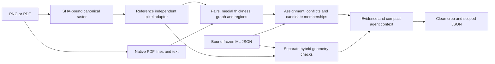

# Implemented local baseline and development findings

The CPU evidence pipeline is implemented in [`deterministic/`](../../deterministic/README.md).
This is a working geometry/evidence baseline with a replaceable pixel extractor.
Its classical recognition is not ready to replace the frozen ML detector.
Everything in this update is local; no push, dataset upload or training occurred.

## What runs now



The primary classes are wall, room, door, window and stairs. Unknown patterns and
unknown room categories remain explicit. ML source scores, measured geometric
support and OCR/native text provenance stay separate. There is no combined
correctness score, automatic authoritative answer or union of source counts.

| Area | Implementation | Practical limit |
| --- | --- | --- |
| Identity/coordinates | PNG preservation, PDF CropBox/rotation transforms, hashes, bounds and schema checks | PDF renders have per-page/total budgets; no implicit metric scale |
| Lines and walls | Orthogonal fits, supported collinear merges, mutual nearest boundary pairs, fill checks, skeleton/Hough medial lines, distance thickness | Reference thresholding fragments thin outlined and scanned walls |
| Topology | Exact intersection noding, `polygonize_full`, holes/islands, dangles/cuts, wall subtraction and explicit gap hypotheses | Unsupported gaps are not repaired into observed walls; no automatic detail-view segmentation |
| Doors | Quarter-arc/angular/leaf evidence followed by opening-strip projection and flanking band checks | Cardinal swing cues only; sliding doors and unknown band width remain unresolved |
| Windows | Parallel lines with wall context; separate glazing-band/endcap detector permitting unequal pane spacing | Furniture/frame/hatch ambiguity remains; source styles differ strongly |
| Stairs | Local axes, repeated tread projections, regular spacing and rail checks | Conservative; curved/cropped flights and source styles without treads are missed |
| Regions/labels | Enclosed free-space regions, opening/wall alternatives and possible-passage relations; contained text room categories | Enclosed regions are not necessarily semantic rooms; no OCR engine is installed |
| Measurements | Explicit/ambiguous unit parser, dimension-line alternatives, scoped verified-anchor calibration helper, pixel lengths/areas and squared-unit conversion | Automatic dimension endpoint verification is not implemented; default physical quantities stay null |
| Cross-checks | STRtree candidate searches, gated maximum-cardinality assignment, class/geometry conflicts and unmatched evidence, complete-link duplicate grouping | Spatial agreement is not proof; no claimed combined-model accuracy improvement |
| Hybrid path | Explicit ML ring repair with raw retention, bounded topology-checked pixel snapping, ML-wall thickness and topology | ML descendants cannot independently confirm parents; dense maps are explicitly unsupported |
| Agent handoff | Full evidence JSON, compact context, numbered class/vector overlays, checksum-checked clean crops and crop-scoped context | Gemini/Jev execution is outside this phase; page counts are not crop quantities |
| Reproducibility | Independent extraction cache by raster/config/source hashes, model binding validation, artifact hashes and run verification tool | Custom Track 1 adapters bypass cache reads; source/profile bindings must be trustworthy |

See [`NOTICE.md`](../../deterministic/NOTICE.md) for the supplied geometry modules
used as the basis and the assumptions deliberately removed. The reference tree
is unchanged. No legacy application, IFC/3D exporter or metric fallback is imported.

## Ten real labeled plans

Use the existing four CubiCasa5K, four ResPlan and two FloorPlanCAD development
cases described in [REFERENCE10.md](REFERENCE10.md). Labels remain outside the
engine and are read only by the separate evaluator. The original frozen pack is
unchanged; results go into a separate derived local pack:
`.artifacts/reference10-track2-v6/`.

Its `review.html` has original source, existing labels, frozen ML, deterministic
candidates, misses/false positives and vector-gap layers. Evidence/raw extraction/
topology JSON links appear beside each case. The engine also exports compact
`agent-context.json`; `crop` creates a clean image plus context limited to that
region. CAD wall/room coverage, incomplete stair annotation and physical units
stay unavailable rather than becoming false zeroes.

This is a small stair-enriched, repeatedly inspected development cohort. It is
not an unseen test set, Stoa evaluation, or a measurement of final question-answer
accuracy. Published labels have not been newly manually re-annotated.

### Failure diagnosis

The measured diagnostic comparison is deliberately retained even where it is
poor. Object/room matches use IoU0.5; wall scores are mean per-plan mask IoU.

| Class | Classical TP / FP / FN | Frozen main TP / FP / FN |
| --- | --- | --- |
| Rooms (77 annotated) | 27 / 15 / 50 | 64 / 46 / 13 |
| Doors (108) | 2 / 42 / 106 | 57 / 102 / 51 |
| Windows (110) | 13 / 202 / 97 | 96 / 120 / 14 |
| Stairs (8, covered pages only) | 0 / 0 / 8 | 1 / 12 / 7 |

The CAD specialist is separately available on its two cases; it is not added to
the main totals. These numbers reject adopting the reference symbol classifiers
as reliable detections. Keep their outputs as visibly uncertain hypotheses for
localized checks; do not derive final answers or exact counts from them.

1. Wall extraction is strongly style-dependent. On the four clean ResPlan
   renders, mean wall IoU is **0.8363**; on the four CubiCasa plans it is **0.2056**.
   The overall eight-plan mean is **0.5210**, versus frozen main ML **0.7356**.
   Thin outlines, hatching, faint scans and unclosed bodies dominate the gap.
2. Classical regions match **27 of 77** labeled rooms, with **15 false positives**
   and **50 misses**, all at mask IoU 0.5. Those 27 matches are on ResPlan.
   Frozen main matches64, with46FP/13FN. Lower raw count error from undercounting
   does not establish better room recognition.
3. The original arc detector returned a swing-symbol box while labels measure a
   wall opening. The engine now retains the arc cue separately and proposes a
   projected opening band. It matches two of four doors on the simplest drawing;
   this is still weak recognition and not verified clear-width measurement.
4. Window panes do not obey stair-like equal spacing. A separate endcap/band rule
   now handles unequal pane spacing and inspects wider context to avoid calling
   a cropped subset of stair treads a window. Generated-array tests cover both.
5. The conservative stair rule misses the annotated real flights. Keep stairs
   unresolved unless stronger source cues or ML proposals support a targeted
   visual check. A zero candidate count is not evidence that no stairs exist.
6. Dense drawings can exceed the declared line budget; the affected page is
   explicitly partial. Native PDF line topology also contains dimensions and
   furniture, so it is not automatically wall topology.

### Engineering verification

**38 tests pass**:27 tests in the new geometry/API package and11 evaluator tests.
They exercise translation-invariant pairing, unsupported gaps, X noding,
holes/islands, safe snapping, ambiguous units, consistent/inconsistent scoped
calibration, text-supported categories, matching/duplicate chains, abstention,
window/tread separation, PNG/rotated-and-cropped PDF integration, ML binding and
ring repairs, lineage cycles, cache reuse, clean crops and path containment.
Ruff lint and formatting pass. CLI analysis/crop run on real source images.

The verifier checks every frozen input checksum, full evidence provenance,
implementation hashes, all generated artifact hashes and unchanged frozen ML
scores. See `GEOMETRY_VERIFICATION.json` in the derived local pack after running:

The completed local run verified **160 unchanged frozen payloads**,10 evidence
documents,124 generated artifact hashes and64 explicitly normalized ML
observations. Frozen ML scores are unchanged. Cold analysis of all ten plans,
including bound-ML geometry checks and artifact writing, took **107.36 seconds**
on this laptop; the slowest page took31.53seconds. This is a local diagnostic
timing, not a standardized throughput benchmark; peak RAM was not measured.

```powershell
.venv/Scripts/python tools/verify_geometry_run.py --pack .artifacts/reference10-track2-v6 --frozen .artifacts/reference10-v1
```

## Track 1 integration and sensible adoption

The current adapter exists to develop and measure Track 2 immediately. Replace
it through `analyze(..., pixel_adapter=...)`, without changing frame, provenance,
class, unknown/coverage or count definitions. The callback receives original RGB
pixels and configuration, never evaluation labels or floorplan ML proposals.
OCR text must retain OCR provenance and its working-frame transform.

Prioritize better observed wall bodies and opening candidates on the failing
scanned/outlined plans. Then rerun the same evaluator and inspect per-case
locations as well as counts. Calibrate physical geometry only with verified
dimension evidence. Keep ML proposals as the stronger baseline; use geometric
agreements and disagreements to select bounded visual checks. Adopt an accuracy
claim only after measuring the integrated result on separate evaluation data.
