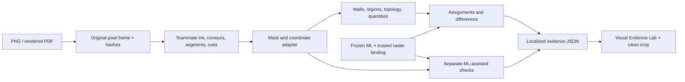

# Pixel extraction, geometry and ML: local integration

The GitHub pixel routines are now the default front end of the local engine.
Both tracks run in one source frame and produce one inspectable document,
preserving independent versus ML-assisted provenance. The local branch is
`deterministic/integrated-evidence`; nothing has been pushed.

## Source and adapter

Observed14November2026,10:49UTC in Willi-CQ/Planproof:

- Original teammate implementation:
  [norlan-deterministic / d4b8c00](https://github.com/Willi-CQ/Planproof/commit/d4b8c003c250bfdccb9e47b8b4d73c367597b21d).
- Integrated source pin, including the Hough coordinate-shape fix:
  [iamd-johan-deterministic-fix /24e3702](https://github.com/Willi-CQ/Planproof/commit/24e37023c9441c657050b8595f1cf738230e6b17).

Both tracks defined `planproof_evidence` with incompatible contracts and
orchestrators. The reviewed pure routines are imported as `track1_pixels.py`;
commit/path/SHA attribution is in
[`TRACK1_SOURCE.json`](../../deterministic/TRACK1_SOURCE.json).
`tools/import_track1.py` reproduces that source selection. The duplicate app,
service, contracts and tracked upstream egg-info are not imported.

`track1_adapter.py` connects CLAHE/Otsu ink, components with holes, contour rings,
LSD/Hough segments and raw opening/stair cues to Track2. It converts0/255 masks
to0/1, NumPy metadata to strict JSON, and records working transforms. It delegates
wall-body preparation, fitting and topology to Track2, without changing original
image orientation or ML identity. Fixed upstream line scores are not treated as
correctness probabilities.

Shape/size opening and rectangular-component stair cues remain unclassified;
the geometry classifiers require additional evidence. The viewer exposes those
raw cues separately. Optional OCR preserves original RGB, uses sparse-text
segmentation and named engine scores. Tesseract is unavailable on this machine,
so OCR reports unavailable; native PDF text remains separate and available.



This phase consumes real frozen predictions bound to these exact drawings; it
does not retrain or rerun ML, or implement Gemini execution. CAD's unsupported
wall/room classes stay N/A and are excluded from comparisons. ML source ring
repairs remain explicit. Hybrid descendants cannot independently confirm parents.

## Visual Evidence Lab

Local output: `.artifacts/reference10-integrated-v1/evidence-lab.html`.
Source: `tools/evidence_lab.html`; builder: `tools/build_evidence_lab.py`.
The builder verifies drawing and input artifact hashes. The page is offline and
uses local source images; no dataset is included in the tracked template.

- Pipeline stages show source, extracted ink, wall vectors, ML comparison and
  localized agent evidence. Class colors are the default: brown walls, blue
  rooms, orange doors, teal windows and purple stairs. Solid outlines are
  deterministic, dashed outlines ML. Method colors remain selectable.
- Toggle each of five classes separately for ML and deterministic evidence.
  Presets isolate either method, both, agreements or differences. Raw cues,
  ML-dependent checks and evaluator labels remain separate optional layers.
- Scores compare each method against supplied labels, either per drawing or on
  exactly the same annotated cases for the selected model. Walls use mean mask
  IoU; rooms/objects use pooled F1 at IoU0.5, with precision, recall and TP/FP/FN.
  Room evaluation uses masks; openings/stairs use boxes. Overlay filters never
  change scores. CAD comparison uses its two supported plans; unsupported or
  unannotated classes remain N/A. Empty-empty classes do not get invented100% F1.
- The agreement table reports class-specific pairs, mean polygon IoU and each
  method's matched raw observations. Clicking a class opens its paired outlines.
  Agreement is not accuracy; conflicts and unmatched records can overlap.
- Two agent reviews supply a concise in-app issue list with source-case buttons,
  including a real P05 room agreement where both sources are evaluator false
  positives. Findings are bound to the failure-report SHA, so another report
  cannot silently inherit them. Detailed observations and next experiments:
  [RESULTS_REVIEW.md](RESULTS_REVIEW.md).
- Select an object/comparison to highlight both sources and inspect a clean
  crop, method, named score, warnings, quantities and dependencies.
- Zoom, pan and fit. Counts stay separate by source. Provenance exposes the
  GitHub pin, model/profile/prediction hashes, raster identity and availability.

The default P05 ResPlan case is readable: main ML has7 room proposals,
geometry10, and existing labels9. Source counts must not be added or treated as
truth. All cases, including poor scanned-plan results, remain accessible.

```powershell
.venv/Scripts/python -m planproof_evidence analyze drawing.png --out .artifacts/job --ml-predictions binding.json
.venv/Scripts/python tools/run_reference10_geometry.py --pack .artifacts/reference10-v1 --out .artifacts/reference10-integrated-v1
.venv/Scripts/python tools/review_reference10.py --pack .artifacts/reference10-integrated-v1 --method main --method cad --method deterministic
.venv/Scripts/python tools/build_evidence_lab.py --pack .artifacts/reference10-integrated-v1
node tools/test_evidence_lab.mjs .artifacts/reference10-integrated-v1
```

Use config `{"pixel_backend":"reference"}` for the older extractor. OCR needs
`deterministic[ocr]` plus the Tesseract executable and requested language data;
availability is detected and included in cache identity. The API/ML binding
contract and clean crop operation are unchanged.

## Measured result and verification

Same ten selected validation plans, repeatedly inspected for development; labels
are evaluator-only. This is not final Stoa QA or an unseen test. Wall means use
8covered plans; object/room matching usesIoU0.5 and explicit annotation coverage.
CAD is scored separately from main ML.

| Measure | Previous reference + geometry | Integrated pixels + geometry | Frozen main ML |
| --- | --- | --- | --- |
| Wall mean IoU | 0.5210 | 0.5336 | 0.7356 |
| Rooms TP / FP / FN | 27 / 15 / 50 | 28 / 20 / 49 | 64 / 46 / 13 |
| Doors TP / FP / FN | 2 / 42 / 106 | 2 / 49 / 106 | 57 / 102 / 51 |
| Windows TP / FP / FN | 13 / 202 / 97 | 12 / 171 / 98 | 96 / 120 / 14 |
| Stairs TP / FP / FN | 0 / 0 / 8 | 0 / 0 / 8 | 1 / 12 / 7 |

The integration works and modestly improves wall overlap. It does not establish
reliable standalone object recognition or better combined answers. Agreement
guides visual verification; disagreement does not establish which source is
correct. Exact physical counts and metric scale remain unresolved.

**48CPU tests pass**, including source adapter, OpenCV fallback shape,
unavailable OCR, unsupported model classes, matched score cohorts, pooled F1 and
undefined metrics. **Eleven browser checks pass** across all ten cases, class
toggles/colors and presets, scores checked against the report, agreement crops,
the shared-error review example, CAD N/A and narrow-screen layout, with no
JavaScript runtime errors. Screenshots are saved beside the dashboard.

All160frozen input payloads and124engine artifact hashes pass;64ML observations
retain explicit source ring normalization. Frozen ML scores are unchanged. A
repeated ten-plan pass with cached independent extraction took50.25seconds on
this machine, including comparisons/artifact writing; this is a local diagnostic
timing rather than a standardized benchmark. All images, labels, predictions,
masks, dashboard data and private brain remain local.
