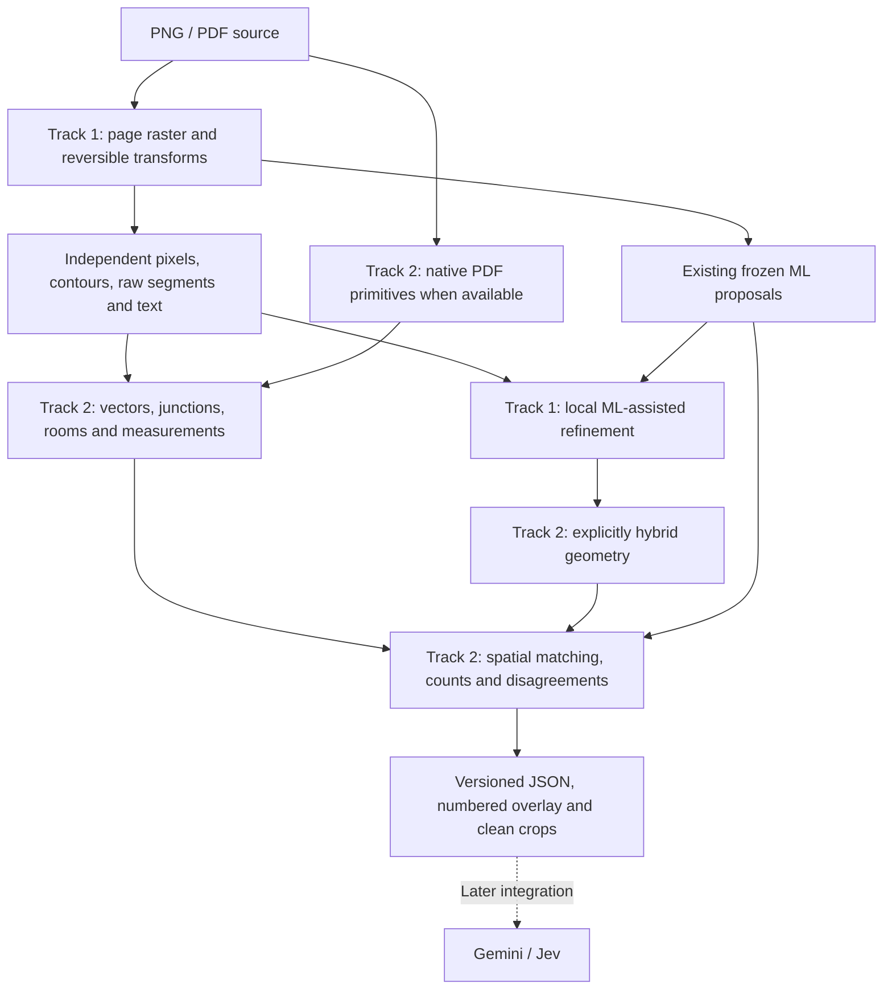

# Planproof: deterministic 2D evidence implementation handoff

**Optional feedback integration (14 November 2026):** [Nemotron feedback and
Stoa zero-shot benchmark](../../feedback/README.md) now implement the visual
feedback role previously reserved for Jev, plus a separate agent self-feedback
route. This newly authorized package consumes clean crop/context artifacts;
it does not add inference to deterministic extraction. The inference exclusion
below describes the earlier engine-only phase. The later primary agent and the
geometry implementation on its separate local branch remain separate work.

Status: **specification ready; engine not implemented**. Updated 14 November 2026.
This document is the entry point for a teammate or AI agent with only this branch.

Local-only update: [ten existing labeled validation plans](REFERENCE10.md) are
prepared for development and failure analysis, with frozen ML comparisons and an
offline viewer. They replace a proposed synthetic base dataset; generated arrays
remain only for focused contract tests. No deterministic classifier is measured yet.

## Outcome and boundaries

Given a PNG or PDF drawing, produce localized, inspectable evidence about walls,
rooms, doors, windows, stair candidates, labels, dimensions, counts and areas.
Compare that evidence with the existing ML proposals without replacing either
source with a single supposed truth. A later Gemini agent and its Jev crop tool
will use these results to answer questions with visual citations.

The supplied Stoa judging criteria weight answer accuracy, visual verification,
creativity and low inference cost equally at 25%. Those are product priorities,
not measured results of this engine. Source extraction must improve both the
evidence and the amount of image context later inference needs.

Current scope is **PNG first, PDF second**. Exclude IFC/DXF/DWG, BIM creation,
3D/mesh export, new ML training, cloud deployment and Gemini/Jev implementation.
Do not build a general construction platform or repair unrelated legacy systems.

## Read in this order

1. This architecture and delivery sequence.
2. [Shared contracts and examples](CONTRACTS.md).
   Then [the algorithm catalogue and rules](ALGORITHMS.md):30 Track2 stages,
   proposed parameters and fixtures that can be prepared before Track1 finishes.
3. Your workstream: [Track 1: pixels](TRACK-1-PIXELS.md) or
   [Track 2: vectors and comparisons](TRACK-2-GEOMETRY.md).
4. [Research and reference-code assessment](RESEARCH.md).

These are ordinary implementation documents. They require no private knowledge
graph, local instructions, original ConstructQ installation or unpublished chats.
The root repository README is intentionally empty; keep it that way.

## Architecture



Independent extraction receives no ML predictions. A second pass may use ML
regions or maps to refine local geometry, but all descendants keep that ML
dependency. A vector fitted to an ML mask is not independent confirmation.
Native PDF primitives and raster approximations also retain different provenance.

## Ownership and parallel work

| Area | Track 1: teammate | Track 2: owner/Codex, the harder task |
| --- | --- | --- |
| Input | PNG/PDF rendering, frames and crop transforms | Native PDF vector/text primitives in the shared frame |
| Extraction | Masks, contours, raw segments, OCR and local symbol cues | Fitted primitives, thickness and graph topology |
| Semantics | Visible door/window/stair candidate cues | Rooms, opening attachment, dimension association and quantities |
| ML | Frozen-output adapter and local proposal refinement | ML/geometry matching, duplicate groups and conflicts |
| Artifacts | Pixel overlays, source crops and extraction cache | Vector overlays, evidence assembly and aggregate membership |
| Checks | Input preservation, transforms, extraction quality and cost | Topology, measurements, comparisons and count/area error |

Track 2 is harder because an attractive vector result can still have incorrect
connectivity or meaning. It owns those geometric/semantic decisions, not all
testing or all infrastructure. Both owners write their own tests and review the
other side's coordinate assumptions. Person 2 must vectorize PNG-derived evidence;
native PDF extraction is an additional path, not a substitute.

Start in separate topic branches, `deterministic/pixel-evidence` and
`deterministic/vector-evidence`, from the same current deterministic branch commit.
Do not modify the frozen ML release. Integrate through normal commits; do not
force-push over teammate work. Shared-contract changes require both owners to
update the fixture and consumer together.

## First implementation decisions

- Create a new Python 3.11+ package under `deterministic/`, import name
  `planproof_evidence`, CLI `planproof-evidence`. Do not depend on the legacy
  packages' global application imports, cloud workers, catalogs or 3D exporters.
- Track 1 owns package/CLI scaffolding, frame types, raster code and the ML adapter.
  Track 2 owns vector code, comparison/measurement logic, final evidence assembly,
  and the first generated inter-track fixture. Both agree contracts before code.
- Base tools: NumPy, SciPy, OpenCV headless, Pillow, Shapely, scikit-image, pypdfium2 and
  pdfplumber. OCR uses pytesseract plus the separately installed Tesseract binary
  and configured language packs. Keep PyTorch/model loading optional and external
  to the CPU geometry package. Pin the tested dependency versions during setup.
- Generated fixtures are diagnostics, not measured real-data accuracy. Do not add
  dataset binaries, extracted partner evidence, private notes or model files here.

## Delivery sequence and equal effort allocation

The following is a planning budget, not a speed or accuracy promise. Each owner
has six focused implementation hours plus the same shared integration time.

| Stage | Duration per person | Track 1 | Track 2 |
| --- | --- | --- | --- |
| Contract kickoff | 30 min together | Agree frames, artifacts and fixture | Agree IDs, topology and measurements |
| Foundation | 2 h | Render, normalize, expose raw pixel primitives | Fit generated primitives, build junction graph |
| Core evidence | 2 h | OCR, opening/tread candidates, local support | Rooms, opening associations, dimensions and areas |
| Cooperation | 2 h | ML adapter, bounded refinement, crops/cache, tests | Comparisons, count membership, final JSON, tests |
| Integration | 1 h together | Inspect overlays and coordinate failures | Inspect topology, quantities and benchmark errors |

Track 2 starts immediately on a generated fixture; Track 1 need not finish first.
First milestone: one generated drawing completes both tracks with aligned JSON,
overlay, counts, areas and an explicit disagreement. Then inspect a representative
development drawing, correct failures, and broaden the development comparison.

## ML baseline and adapter boundary

The implementation and frozen weights are available independently:

- [Baseline model card, restore and inference](https://github.com/Willi-CQ/Planproof/blob/ml/trained-baseline-v1/models/baselines/v1/README.md).
- [ML schema](https://github.com/Willi-CQ/Planproof/blob/ml/trained-baseline-v1/ml/src/planproof_ml/schema.py)
  and [inference implementation](https://github.com/Willi-CQ/Planproof/blob/ml/trained-baseline-v1/ml/src/planproof_ml/inference.py).
- Frozen publication commit: `82470b0f08c81da21b2bbef6b08f4d9dc58ff7bc`.

Use a separate authorized clone/worktree for ML execution. Do not merge its large
model files into this branch. Prefer receiving existing prediction JSON and
optional main-model maps; the deterministic engine must run without them.

Main bundle: `corrected-3500-global`; CAD specialist: `cad-objects-3000-global`.
Both use global1024 with their bound calibration, so retain `--global-view`.
The CAD output supports doors/windows/stairs only; do not read walls, room types
or dense maps from it. Main stairs are unreliable. Model scores are probabilities,
not probabilities of correctness. Two ML models do not become two independent
geometric observations. Existing component scores do not establish Stoa QA accuracy.

After restoring/installing the ML environment in that separate checkout, this is
an existing supported inference command. Replace the capitalized placeholders
with the canonical page image and recorded document hash:

```bash
planproof-ml infer \
  --checkpoint models/baselines/v1/corrected-3500-global/detector.pt \
  --calibration models/baselines/v1/corrected-3500-global/calibration.json \
  --global-view --image PAGE.png --document-id SOURCE_SHA256 --page-index 0 \
  --save-probabilities --out .artifacts/ml/main --device cpu
```

It writes `detections.json`, `overlay.png` and `probabilities.npz`. Track 1 creates
the binding document around these outputs. For the CAD specialist, change the
bundle and omit `--save-probabilities`. A compatible GPU is optional for inference;
no GPU access is required to implement or test the CPU evidence package.

## Drawing access and local validation inputs

This branch deliberately includes no Stoa drawings/questions or evaluation split
files. Implementation starts with generated fixtures and needs no dataset access.
For real-data checks, use a locally supplied authorized development manifest with
source drawing/group IDs, file hashes and split assignments. Store input/output
files under ignored `.artifacts/`; do not assume another person's private paths.

Use the team's existing development/final partition if supplied. If it is absent,
report that real-data validation is pending and request the authorized development
inputs; do not silently rebuild a split, inspect final answer keys, download a
large partner archive or substitute fixtures for a real-data accuracy result.
The initial generated end-to-end milestone remains executable without that access.

## Definition of done

- Installable standalone CLI/library, documented setup and actual commands.
- PNG and multipage PDF processing with source preservation and tested transforms.
- Independent extraction works with ML disabled; hybrid outputs declare parents.
- Supported quantities link to object membership or calculation inputs. Missing
  calibration never produces asserted metres or square metres.
- JSON, numbered overlay and clean source crops agree spatially. Incomplete page
  coverage, missing OCR and unsupported interpretations are explicit.
- Controlled tests pass, including topology/measurement adversarial cases in both
  workstream documents. Crop/overlay alignment is within one canonical pixel on
  controlled fixtures; native/raster transforms round-trip within 0.5 pixel.
- Report development comparisons for ML-only, classical-only and combined
  evidence: precision/recall, count error, matched-room overlap/area error,
  unsupported cases, cold/warm CPU time, peak memory and cache behavior.
- Keep final-evaluation answers sealed. Do not train on Stoa, change frozen ML
  thresholds using final tests, or present detector metrics as final QA accuracy.

Record measured failures and limitations. No target accuracy has yet been proven
for this engine. Leave low-support alternatives visible for later Jev inspection.
