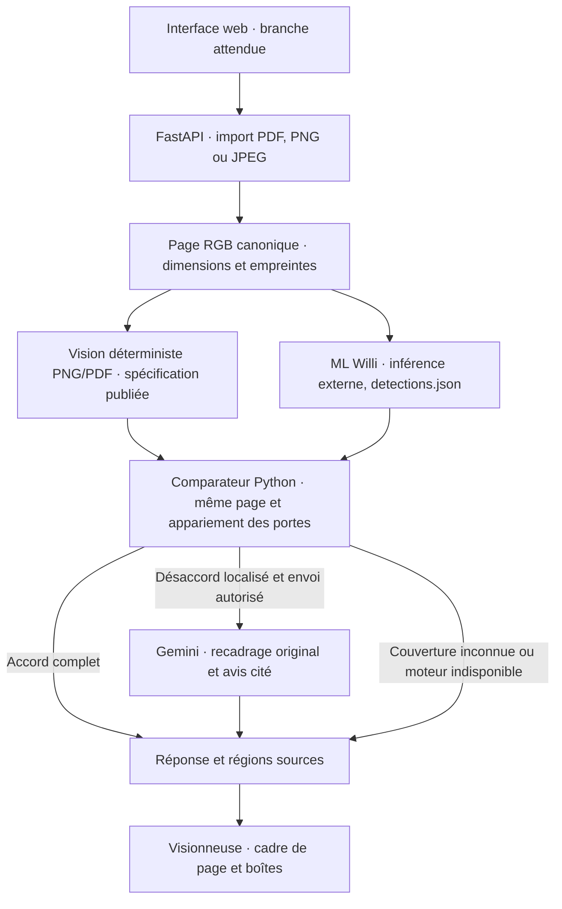

# PlanProof — contexte projet pour l’audit

Projet d’équipe Junction 2026, challenge STOA « Make Blueprints Talk » et intégration Google Gemini. L’utilisateur doit pouvoir poser une question sur un plan et inspecter la région source qui soutient la réponse. Le premier cas intégré porte sur les portes d’une seule page. L’interface de production et la couverture de questions restent à étendre.

## Architecture V3



Python décide du statut. Gemini n’est appelé que pour une divergence localisée et autorisée dans le parcours V3. Il reçoit le recadrage sans annotations, les résumés des moteurs et les identifiants candidats. Il renvoie un avis structuré. Le statut reste `NEEDS_REVIEW` pour la divergence. Plusieurs propositions concordantes ne suffisent pas à prouver que la page a été couverte intégralement.

Le prototype initial de recherche exacte `FD-12` reste disponible via `/api/analyze` et sa démo via `/api/demo`. Son option Gemini appartient à ce prototype. Le point de raccordement V3 est `/api/v1/door-count`. Pour l’instant, l’API prend les résultats des moteurs en entrée. Elle ne lance pas de modèle ni d’entraînement.

## Dépôt et branches

Origine `Willi-CQ/Planproof`. État distant inspecté au début de cette intégration.

| Branche | Révision inspectée | Contenu et rôle |
| --- | --- | --- |
| `main` | `76a3cd7` | Registre de sources publiques et politique de stockage des données. Le registre local `data/manifest.csv` est retiré de cette branche. |
| `deterministic-algorithms` | `de71906` | Bibliothèques de géométrie et CAD existantes sous `geometry/`, plus la spécification 2D sous `docs/deterministic-evidence/`. Le nouveau moteur PNG/PDF est annoncé comme à implémenter dans le handoff. |
| `ml/trained-baseline-v1` | `82470b0` | Package `ml/`, inférence et entraînement, profils de calibration et poids versionnés via Git LFS. |
| `iamd-johan-dev` | `48e599a` puis le commit qui contient ce document | API FastAPI, comparaison, intégration Gemini, adaptateur ML, tests et guide. |

Le remote a exposé ces quatre branches. Aucun frontend applicatif ni référence de PR visible n’a été trouvé. La publication du frontend est attendue séparément. Le frontend prévu doit superposer les boîtes sur le PNG servi par l’API et présenter le verdict Python et l’avis Gemini dans des champs distincts.

Imad et Johan travaillent sur le contrat du backend, le comparateur et Gemini. Willi a publié l’entraînement et l’inférence ML, exécutés durant le projet avec la puissance de calcul Verda selon l’équipe. Le handoff associe Willi et Norlan à la voie déterministe PNG/PDF. Confirmer avec l’équipe qui maintient l’interface.

## Entrées et sorties des moteurs

**ML.** `corrected-3500-global` est le modèle principal pour murs, pièces et ouvertures. `cad-objects-3000-global` se limite aux portes, fenêtres et escaliers. Le modèle principal utilise une vue globale à 1024 avec son profil de calibration. Le package exige Python 3.11 ou 3.12, distinct de l’environnement backend si nécessaire. Le checkpoint principal vérifié mesure 97 941 718 octets et a pour SHA-256 `c1861511904636f16433d5a0ec7b925c53a323c975a10df7e1886666a6e1bc54`. Le rapport interne décrit 2 051 dessins dans le test projet, IoU murs 0,713, mAP50 objets 0,587 et F1 pièces 0,739. Ces métriques évaluent des composants et ne démontrent pas l’exactitude des réponses sur STOA. [Livraison ML](https://github.com/Willi-CQ/Planproof/tree/ml/trained-baseline-v1/models/baselines/v1)

**Déterministe.** L’ancien `planproof_cad` convertit un DXF en scène et `api.takeoff` calcule des quantités depuis cette scène. Les coordonnées, unités, hypothèses et sources du métré suivent le contrat CAD. Le nouveau parcours PNG/PDF prévoit des observations en pixels, des résultats indépendants ou hybrides, des agrégats et des liens vers les régions du plan. Un résultat raffiné à partir de propositions ML garde cette dépendance et ne peut servir de confirmation indépendante. Pour l’intégration V3, obtenir un exemple exécutable qui fournit les boîtes de portes sur le même raster. [Contrats déterministes](https://github.com/Willi-CQ/Planproof/blob/deterministic-algorithms/docs/deterministic-evidence/CONTRACTS.md)

## Surface de l’API

| Route | Raccordement |
| --- | --- |
| `POST /api/documents` | Multipart `file` et `page` facultatif à partir de 1. PDF, PNG ou JPEG. Renvoie un `document_id`, `image_url` et les dimensions du raster. |
| `GET /api/documents/{document_id}/image` | PNG RGB canonique pour la visionneuse et l’inférence. |
| `GET /api/v1/documents/{document_id}/frame` | Index de page à partir de 0, SHA-256 du fichier et des pixels RGB, largeur, hauteur et convention des coordonnées. |
| `POST /api/v1/door-count` | JSON avec `document_id`, `deterministic`, `ml_detections` brut ou `ml` normalisé et `allow_gemini_review` facultatif. |
| `POST /api/v1/demo/door-count` | Démo synthétique nommée `agreement`, `disputed` ou `missing_ml`. |

Les résultats normalisés suivent `planproof-door-result-v1`. Un moteur renseigne sa version, son statut, son indépendance, la couverture et une liste d’assemblages de porte avec ID et boîte. Les boîtes suivent `[x0, y0, x1, y1]` dans le raster affiché, origine en haut à gauche. Les coordonnées sont en pixels. Le `document_id` API est un identifiant de session. Dans le JSON natif de Willi il faut omettre `--document-id` à l’inférence afin que le champ contienne le hash des pixels RGB. L’adaptateur valide ce hash, les dimensions, la page et les boîtes avant de lier les détections à la session. La couverture brute du ML reste inconnue.

La réponse porte `status`, `answer` entier ou null, `reasons`, `source`, `image_url`, les paires et leurs boîtes, les boîtes contestées, les propositions non vérifiées et l’avis `gemini`. Le frontend doit afficher une proposition isolée comme non vérifiée. La politique actuelle demande un appariement univoque avec IoU ≥ 0,5 et une couverture complète déclarée par les deux moteurs pour publier un nombre exact. Ce seuil n’a pas encore été calibré sur les plans STOA.

## Exécution et vérification

Depuis la racine du dépôt avec Python et un environnement dédié au backend.

```powershell
python -m pip install -r backend/requirements.txt
python -m unittest discover -s backend -v
python -m uvicorn app:app --app-dir backend
```

Pour un essai réel Gemini, `python backend/check_gemini.py --serve` invite à saisir la clé du projet dans le terminal. Le script envoie un seul recadrage de la démo synthétique et lance le serveur local sur le port 8001 si l’appel réussit. Le 14 novembre, l’équipe a observé une réponse réelle `SUPPORTS_DETERMINISTIC` citant `deterministic:2`, avec statut PlanProof `NEEDS_REVIEW`. Le résultat des moteurs sur cette page était simulé. Le guide explique comment raccorder les sorties du ML et de Gemini. [Commandes de démo et intégration](gemini-arbitration.md)

Le backend a passé 12 tests automatisés. Ils couvrent l’import et le repère de coordonnées, les divergences de position, les doublons, les entrées invalides et les réponses Gemini simulées. Le transport simulé vérifie aussi la sérialisation effective du PNG et du schéma par le SDK Google.

Un essai séparé a exécuté le vrai modèle `step-3500-c18615119046` avec Torch CPU et le profil de calibration du bundle, sur le PNG de la démo synthétique. La commande a pris 36,4 secondes sur cette machine, démarrage et chargement du modèle inclus. Elle a produit zéro instance sur ce dessin. L’API a accepté le JSON natif lié au raster et a renvoyé `INSUFFICIENT_EVIDENCE` avec une réponse nulle. Cet essai valide le raccordement ML à l’API, et ne constitue ni une mesure de précision ni un test des deux moteurs réels.

## Priorités de l’audit Claude Code

1. **Valider la provenance.** Les données envoyées par l’API supposent deux producteurs locaux de confiance. Une empreinte valide lie l’image mais n’authentifie pas un résultat fourni par un client. Avant d’exposer publiquement le service, établir une frontière de confiance côté serveur et contrôler qui peut demander un appel Gemini.
2. **Vérifier la cohérence des boîtes.** Tester références, orientation, page et correspondance entre raster affiché et image analysée sur un PDF vectoriel et un scan autorisés. Analyser à part les erreurs de détection, d’appariement et de couverture.
3. **Intégrer les deux vrais producteurs.** Brancher à terme leurs points d’entrée, garder leurs versions et tester le même PNG annoté. Les classes supportées, les détections manquées et les résultats sur des pages réelles sont encore à mesurer ensemble.
4. **Brancher la visionneuse.** Tester le parcours utilisateur complet à partir du futur frontend. Les résultats doivent rester inspectables lors d’une indisponibilité de Gemini ou de l’un des moteurs.
5. **Contrôler le lancement et le déploiement.** Le backend est local, conserve huit pages en mémoire et perd son état au redémarrage. Les traitements bloquants et les ressources d’upload nécessitent des limites adaptées avant une exposition multiutilisateur. Les sources et poids doivent suivre le registre du projet. Les clés, documents sensibles et fichiers générés restent hors du commit.

Le premier test complet sur un exemple autorisé doit reproduire une question sur les portes, deux sorties authentiques, une comparaison sur la même page et un clic vers une région qui permet de juger la réponse.
